# Shopmate POS - Offline-First Point of Sale & Retail Billing System

[](https://flutter.dev)
[](https://dart.dev)
[](#6-system-architecture)
[-blue)](https://drift.simonbinder.eu)
[-blue)](https://github.com/itz-sk-luffy/Shopmate/releases/tag/v1.0.0)
[](#10-project-setup-instructions)
[](#15-developer-information)
[](#15-developer-information)

---

## 1. Project Title – Shopmate POS

**Shopmate POS** is a modern, high-speed, offline-first Point of Sale (POS) and retail store billing application built with Flutter. Engineered specifically for small-to-medium retail outlets, grocery stores, kirana shops, and general merchants, Shopmate delivers uncompromising checkout speed, hardware-accelerated thermal printing, and resilient local data persistence without requiring an active internet connection.

---

## 2. Project Overview

In traditional retail and grocery environments, billing bottlenecks, slow internet connections, and expensive monthly cloud subscriptions hinder counter productivity. **Shopmate POS** was designed and implemented from the ground up to solve these operational pain points.

The application operates entirely on-device using a typed SQLite database powered by Drift. It delivers a fluid 60 FPS experience even on entry-level Android devices (such as devices with 2 GB RAM running Android 13 Go Edition). Shopmate integrates directly with standard retail hardware—including external USB/Bluetooth physical barcode scanners (via global hardware keyboard interception) and 58 mm ESC/POS Bluetooth thermal printers—allowing merchants to ring up orders, calculate weight-based pricing, issue professional GST-compliant receipts, and track customer credit seamlessly.

### Core Highlights
* **Zero Cloud Dependency**: 100% offline functionality. No login servers, third-party APIs, or recurring SaaS fees.
* **Instantaneous Checkout**: Global physical barcode wedge listener adds items to cart instantly without requiring UI focus.
* **Hardware Thermal Printing**: Direct 58 mm Bluetooth ESC/POS printing (32 characters per line) and shareable A4 GST Tax Invoices.
* **Customer Udhaar (Credit) Ledger**: Track customer receivables with one-tap WhatsApp payment reminders.
* **Audit-Safe Operations**: In-place past bill editing with full audit trail logs, plus a 30-day soft-delete Recycle Bin.

---

## 3. Project Objectives

1. **Maximize Counter Throughput**: Enable high-speed barcode scanning, quick-weight presets, and rapid cash tender shortcuts to finalize bills in under 5 seconds.
2. **Ensure Complete Offline Autonomy**: Protect merchant operations from network dropouts through localized SQLite storage and scheduled offline database backups.
3. **Hardware Accessibility**: Support affordable retail peripherals, including Bluetooth thermal printers, USB handheld barcode guns, and low-cost Android smartphones and tablets.
4. **Maintain Strict Financial Integrity**: Implement automated Indian GST calculations (inclusive and exclusive), round-off logic, and end-of-day cash drawer reconciliation.
5. **Preserve Device Efficiency**: Keep APK distribution compact (< 25 MB per ABI) and minimize runtime memory usage via isolate-based background processing and image downsampling.

---

## 4. Key Features

### 🛒 High-Speed Billing & Checkout
- **Hardware Barcode Wedge Listener**: Global keyboard event interception handles inputs from external handheld USB and Bluetooth barcode scanners without requiring focus on a search field.
- **Integrated Camera Scanner**: High-speed camera barcode scanning with torch control and haptic feedback via `mobile_scanner`.
- **Loose Item / Weighed Products**: Quick weight preset buttons (100g, 250g, 500g, 1kg, 2kg, 5kg), custom decimal input, and automatic subtotal calculation.
- **Quick Cash Tender**: Smart cash tender suggestions (Exact, ₹100, ₹200, ₹500, ₹2000) with live change-due display and zero dead-space layout.
- **Multi-Mode Payment**: Supports Cash, UPI, Debit/Credit Card, Udhaar (Store Credit), and Split Payments (Cash + Digital).
- **Dedicated Order Complete Hub**: Instant full-screen post-checkout screen featuring 1-tap 58 mm Bluetooth thermal printing, WhatsApp A4 PDF sharing, A4 print preview, and quick-start next sale.
- **Held Bills (Parked Carts)**: Park incomplete customer carts during counter delays and restore them anytime.
- **Dynamic Quick Item Entry**: Add custom or uncataloged items directly to the active bill with an option to simultaneously save them to the product catalog.

### 📦 Product & Category Management
- **Catalog CRUD**: Manage products with custom SKU/barcodes, pricing, tax rates, unit types (`pcs`, `kg`, `g`, `l`, `ml`, `pack`), and category tags.
- **Category Hierarchy & Assignment**: Create, edit, and organize product categories, with multi-product batch assignment.
- **In-App Google Web Image Search**: Built-in WebView allows store owners to search product images online, automatically crop 1:1, downsample in a background isolate, and assign them without API keys.
- **Android Share Target**: Share images directly from Android Gallery or WhatsApp into Shopmate to instantly populate product images.
- **Barcode Label Generator**: Generate and print Code128 barcodes formatted for 58 mm thermal printers.
- **Catalog Import / Export**: Bulk CSV import and export for rapid inventory initialization.

### 🧾 Invoicing & Receipt Printing
- **58 mm ESC/POS Bluetooth Thermal Printing**: Specially formatted 32-character receipts with store branding, itemized breakdowns, tax summaries, savings summaries, and customizable footer notes.
- **A4 GST Tax Invoices**: Generates professional, GST-compliant A4 PDF documents with HSN/SAC codes, CGST/SGST breakdowns, and Indian currency amount in words (*e.g., "One Thousand Four Hundred Fifty Rupees Only"*).
- **Digital Sharing**: Instant sharing of PDF invoices via WhatsApp, email, or system print services using `share_plus` and `printing`.

### 👥 Customers & Udhaar (Credit) Ledger
- **Customer Directory**: Track customer contact info, purchase history, and outstanding balances.
- **Swipe-to-Delete**: Swipe left on any customer ledger row to quickly delete with confirmation.
- **One-Tap WhatsApp Reminders**: Generate direct WhatsApp payment reminder links (`wa.me`) with pre-filled balance statements and merchant UPI details.
- **Direct Credit Settlement**: Settle outstanding balances directly from the customer ledger or during order review.

### 📋 Orders History & Past Bill Auditing
- **Real-Time Order Streams**: Filter transactions by date range, payment mode, or customer name.
- **In-Place Bill Editing**: Modify past bills while preserving original bill numbers.
- **Permanent Audit Trail**: All bill edits log previous subtotals, new subtotals, modification timestamps, and reason notes into an immutable `BillEdits` table.

### 💰 Cash Register & Day-End Closing
- **Daily Drawer Reconciliation**: Tracks opening cash balance, cash sales, cash expenses, customer credit payments, and calculates the expected cash in hand:
  $$\text{Expected Cash} = \text{Opening Balance} + \text{Cash Sales} + \text{Credit Collected} - \text{Cash Expenses}$$
- **Denomination Breakdown & Quick Add**: Built-in physical currency denomination counter (+₹100, +₹200, +₹500, +₹2000, Exact) and discrepancy calculation.
- **Swipe-to-Delete Past Closings**: Swipe left on past closing history records to remove obsolete entries.
- **End-of-Day Thermal Report**: Prints a consolidated register summary on 58 mm thermal paper before closing.

### 📱 Poco C51 & Device Performance Tuning
- **Ultra-Low Memory Footprint**: Hard 15 MB in-memory image cache cap with automatic trimming under Android native low-memory signals (`onTrimMemory`).
- **Device-Native Keyboard Entry**: Utilizes system numeric keyboard avoiding slow in-app virtual keyboard overhead.
- **Dynamic App Launcher Icon Presets**: Switch between 4 distinct store branding icons (Classic Blue, Neon Green, Warm Amber, Neon Purple) on the home screen.
- **Smooth 60 FPS Charts**: Cubic spline hourly sales trends and real-time dashboard analytics.

### 🛡️ Data Protection, Security & Maintenance
- **Biometric & PIN Lock**: Secure POS access with a 4-digit master PIN and fingerprint/face authentication via `local_auth`.
- **Single-Archive Offline Backups**: Export and import unencrypted `.zip` backups containing the SQLite database, custom images, and JSON configuration.
- **Safety Fallback**: Automatic safety backup created before any database restore.
- **Automated Background Backup**: Daily and weekly background backups scheduled via `workmanager`.
- **30-Day Recycle Bin**: Soft-delete architecture for products, bills, and expenses with a 30-day auto-purge policy and instant restoration capability.

---

## 5. Technology Stack

| Layer | Technology | Details |
|---|---|---|
| **Framework** | [Flutter](https://flutter.dev) (v3.47+) | Cross-platform UI toolkit targeting Android Material 3 |
| **Language** | [Dart](https://dart.dev) (v3.5+) | Strongly-typed, sound null-safe programming language |
| **State Management** | [Flutter Riverpod](https://pub.dev/packages/flutter_riverpod) (v2.6+) | Unidirectional data flow, StateNotifiers, Stream & Future providers |
| **Local Database** | [Drift](https://pub.dev/packages/drift) (v2.19+) + SQLite | Type-safe reactive SQLite persistence with background isolates |
| **Routing** | [GoRouter](https://pub.dev/packages/go_router) (v14.8+) | Declarative routing with onboarding and PIN authentication guards |
| **Barcode Scanning** | [Mobile Scanner](https://pub.dev/packages/mobile_scanner) + HardwareKeyboard | Camera scanning + global hardware keyboard wedge listener |
| **Thermal Printing** | [print_bluetooth_thermal](https://pub.dev/packages/print_bluetooth_thermal) + [esc_pos_utils_plus](https://pub.dev/packages/esc_pos_utils_plus) | ESC/POS byte generator for 58 mm Bluetooth receipt printers |
| **PDF Generation** | [pdf](https://pub.dev/packages/pdf) + [printing](https://pub.dev/packages/printing) | A4 GST Tax Invoice formatting, preview, and Android print spooler |
| **Image Processing** | [flutter_image_compress](https://pub.dev/packages/flutter_image_compress) | Multi-threaded image downsampling (max 400px @ 80% quality) |
| **Background Tasks**| [workmanager](https://pub.dev/packages/workmanager) | Periodic offline backup execution and storage cleanup |
| **Security** | [local_auth](https://pub.dev/packages/local_auth) | Biometric authentication (fingerprint / face unlock) |

---

## 6. System Architecture

Shopmate follows a **Feature-First Clean Architecture** with strict separation of concerns, reactive streams, and isolated database execution.

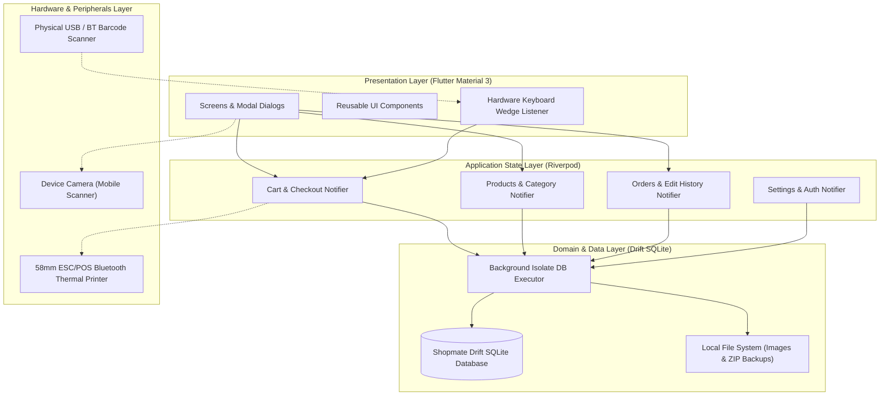

### Architecture Highlights
1. **Background Database Execution**: Database queries run in an independent background isolate to prevent UI frame drops during heavy transactions.
2. **Reactive UI Updates**: Presentation components subscribe to Drift streams via Riverpod `StreamProvider`, automatically updating the UI upon database mutations.
3. **Hardware Isolation**: Peripherals (printers, physical barcode scanners, camera) are abstracted behind service layers with fallback handling.

---

## 7. Application Modules

```
lib/
├── core/
│   ├── database/          # Drift AppDatabase schema, tables, DAOs, seeding
│   ├── providers/         # Global Riverpod providers (database, auth, theme)
│   ├── routing/           # GoRouter route hierarchy and navigation guards
│   ├── services/          # Android share target and hardware services
│   ├── theme/             # Material 3 color palettes and typography
│   ├── utils/             # Formatters, Indian currency words, calculations
│   └── widgets/           # Shared UI buttons, dialogs, badges, inputs
└── features/
    ├── auth/              # Master PIN verification and biometric unlock
    ├── backup/            # ZIP backup creation, restore, Workmanager sync
    ├── customers/         # Customer ledger, transactions, WhatsApp reminders
    ├── dashboard/         # Real-time metrics, payment split, hourly sales
    ├── day_closing/       # Cash register balancing and closing receipt
    ├── expenses/          # Categorized expense tracking and daily summaries
    ├── more/              # Quick navigation hub for tools and configuration
    ├── onboarding/        # First-run setup wizard (store profile & PIN)
    ├── orders/            # Order history, timeline, in-place bill editing
    ├── pos/               # High-speed cart, loose weight modal, cash pad
    ├── printer/           # 58mm thermal generator and A4 GST PDF invoice
    ├── products/          # Catalog management, categories, web image picker
    ├── recycle_bin/       # 30-day soft-delete auto-purge and restore
    ├── reports/           # Sales summaries, GST tax reports, CSV export
    ├── settings/          # Store profile, taxes, bill sequence, color theme
    └── shell/             # Main responsive bottom navigation shell
```

---

## 8. Database and Offline Storage

The local database is powered by **Drift (SQLite)** and features 10 relational tables optimized with custom indexes and compound foreign keys:

| Table | Purpose | Key Columns / Indexes |
|---|---|---|
| `products` | Retail product catalog | `id`, `name`, `barcode` (Indexed), `selling_price`, `cost_price`, `category_id`, `unit`, `is_deleted` |
| `categories` | Product grouping | `id`, `name`, `color`, `icon`, `is_deleted` |
| `bills` | Finalized sales orders | `id`, `bill_number` (Indexed), `subtotal`, `tax_total`, `grand_total`, `payment_mode`, `created_at` |
| `bill_items` | Individual bill line items | `id`, `bill_id` (Indexed), `product_id`, `product_name`, `quantity`, `unit_price`, `total` |
| `bill_edits` | Audit log of past bill edits | `id`, `bill_id` (Indexed), `previous_total`, `new_total`, `edited_at`, `notes` |
| `customers` | Customer directory | `id`, `name`, `phone` (Indexed), `current_balance`, `is_deleted` |
| `customer_transactions` | Credit (Udhaar) ledger logs | `id`, `customer_id` (Indexed), `bill_id`, `amount`, `transaction_type`, `created_at` |
| `expenses` | Daily operational expenses | `id`, `title`, `amount`, `category`, `payment_mode`, `created_at`, `is_deleted` |
| `day_closings` | End-of-day register audits | `id`, `closing_date` (Indexed), `opening_cash`, `cash_sales`, `expected_cash`, `actual_cash` |
| `settings_entries` | Key-value store configuration | `key` (Primary Key), `value` |

### Storage Characteristics
- **Storage Path**: Standard Android app sandboxed storage (`/data/user/0/com.shopmate.pos/databases/shopmate.sqlite`).
- **Product Images**: Stored locally in `/data/user/0/com.shopmate.pos/app_flutter/products/` as compressed JPEG files (max 400px width, 80% quality).
- **Backup Format**: Uncompressed/Deflated `.zip` archive containing:
  - `shopmate.sqlite` (Database snapshot)
  - `products/` (Catalog images folder)
  - `settings.json` (Store metadata)

---

## 9. Installation Requirements

Before building and running Shopmate POS, ensure your development environment satisfies:

* **Flutter SDK**: `v3.24.0` or higher (tested with `Flutter 3.47.0-1.0.pre`)
* **Dart SDK**: `v3.5.0` or higher
* **Android SDK**: API Level 21 (Android 5.0) minimum, API Level 34 (Android 14) target
* **Java Development Kit**: JDK 17
* **Android Studio** or **Visual Studio Code** (with Flutter & Dart extensions)
* **Git**: Version 2.20 or higher

---

## 10. Project Setup Instructions

### 1. Clone the Repository
```bash
git clone https://github.com/itz-sk-luffy/Shopmate.git
cd Shopmate
```

### 2. Install Dependencies
Download and cache the required Flutter packages:
```bash
flutter pub get
```

### 3. Verify Static Analysis
Ensure there are no compile warnings or lint violations:
```bash
flutter analyze
```

### 4. Execute the Test Suite
Run the 92 comprehensive unit and widget tests:
```bash
flutter test
```
*Expected output: All 92 tests pass successfully.*

---

## 11. How to Run the Application

### Running in Debug Mode
Connect an Android device (with USB debugging enabled) or start an Android emulator, then run:
```bash
flutter run
```

### Running in Release Mode (Optimized)
To test true 60 FPS performance and hardware bindings on a physical device:
```bash
flutter run --release
```

### Building Release APKs

#### 1. Split-per-ABI Release APKs (Recommended for Production)
Generate optimized, low-footprint Android APK packages under 25 MB:
```bash
flutter build apk --release --split-per-abi
```
Generated files in `build/app/outputs/flutter-apk/`:
- `app-armeabi-v7a-release.apk` (21.8 MB) — *Optimized for entry-level devices (Poco C51, Android Go)*
- `app-arm64-v8a-release.apk` (22.3 MB) — *Recommended for standard 64-bit devices*
- `app-x86_64-release.apk` (23.0 MB) — *For Android emulators & x86_64 tablets*

#### 2. Universal Release APK (All-in-One)
Generate a single universal APK compatible with all Android architectures:
```bash
flutter build apk --release
```
Generated file: `build/app/outputs/flutter-apk/app-release.apk` (46.8 MB)

All release builds can also be downloaded directly from [GitHub Releases](https://github.com/itz-sk-luffy/Shopmate/releases/tag/v1.0.0).

---

## 12. Screenshots

### 🛒 High-Speed POS Counter, Cart & Order Completion
| POS Billing Catalog (Grid) | Cart & Counter Billing | Checkout & Payment | Order Complete & Receipt |
|:---:|:---:|:---:|:---:|
| 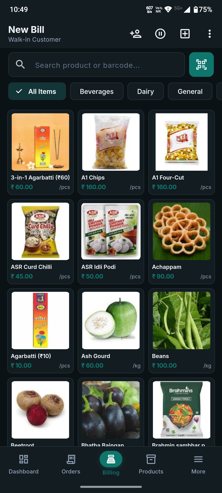<br><sub>*High-Speed Product Grid, Search & Category Filters*</sub> | 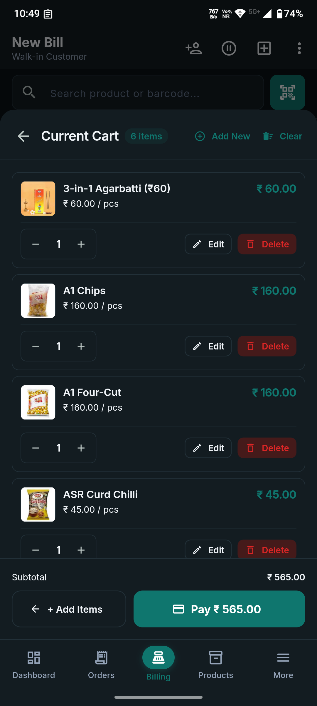<br><sub>*Live Subtotal, Line Items & Add/Clear Actions*</sub> | 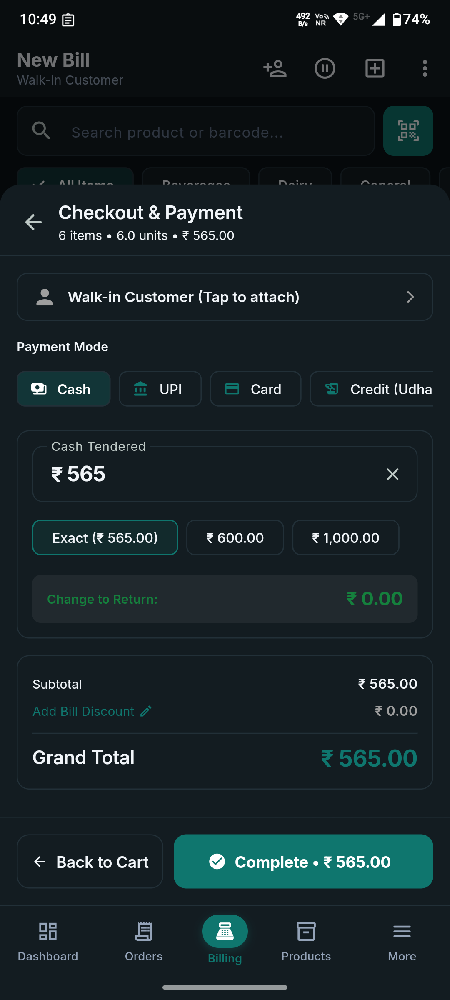<br><sub>*Quick Cash Shortcuts, Change Calculation & Multi-Pay*</sub> | 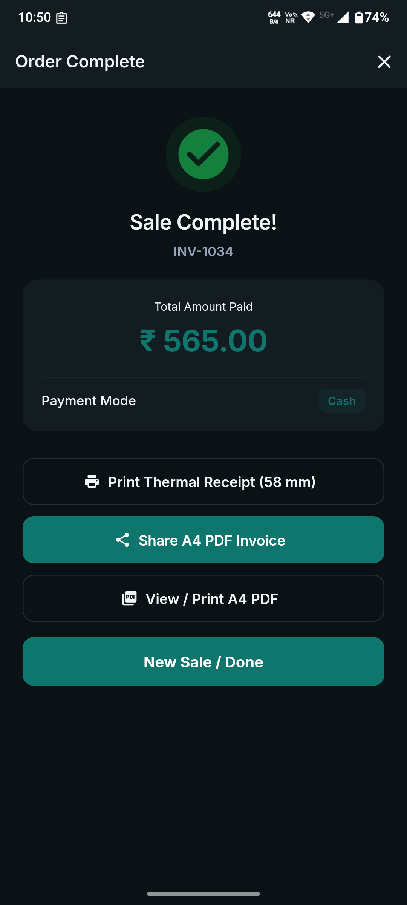<br><sub>*Direct 58mm Thermal Print, A4 PDF Share & New Sale*</sub> |

### 📊 Real-Time Analytics & Store Management
| Dashboard & Hourly Sales Trend | Day-End Register Closing | Reports & Analytics | Store Settings & Presets |
|:---:|:---:|:---:|:---:|
| 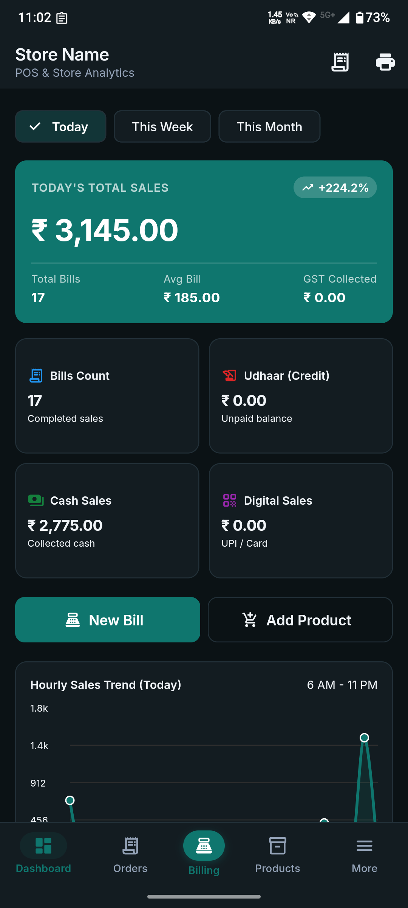<br><sub>*Live Sales Metrics, Metrics Cards & Hourly Curve*</sub> | 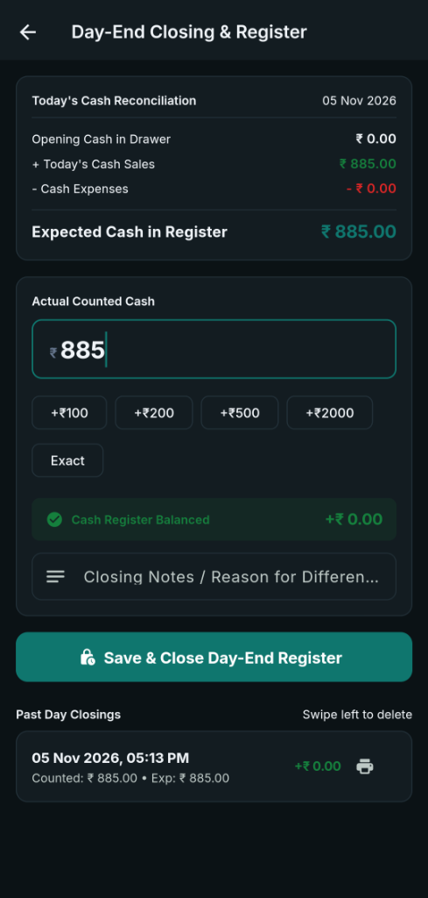<br><sub>*Cash Drawer Reconciliation & Swipe-Left Delete*</sub> | 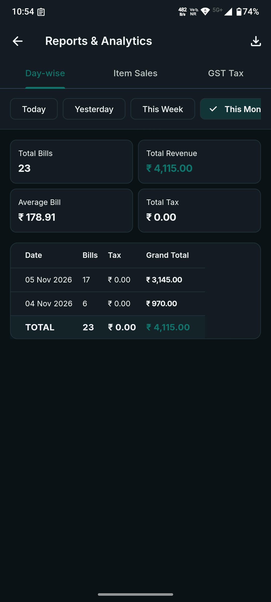<br><sub>*Day-Wise Sales, Item Breakdown & Tax Summaries*</sub> | 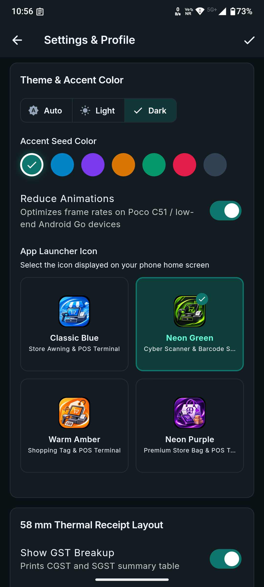<br><sub>*Themes, Poco C51 Optimizations & Icon Presets*</sub> |

### 🧾 Invoicing, Hardware & Auditing
| Product Catalog Management | Past Orders & Audit Details | 58 mm Thermal Printer Setup | A4 GST Tax Invoice (PDF) |
|:---:|:---:|:---:|:---:|
| 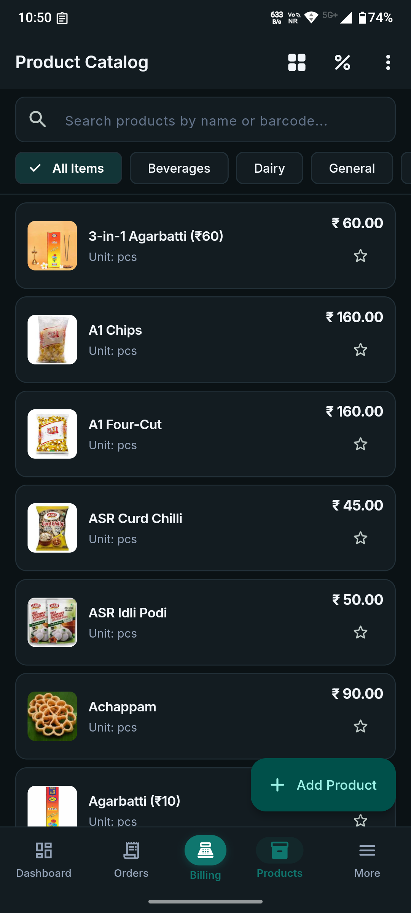<br><sub>*Clean Stock List, Pricing & Quick Add*</sub> | 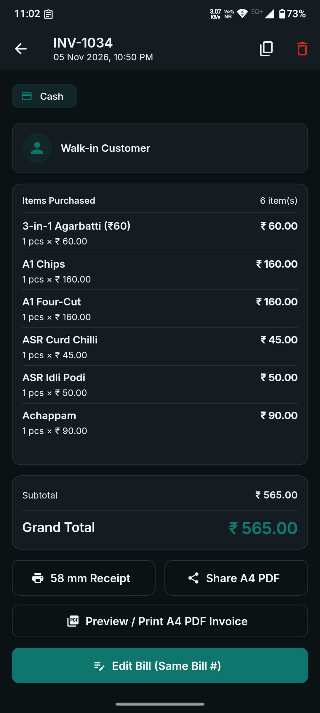<br><sub>*Itemized Breakdown & In-Place Bill Auditing*</sub> | 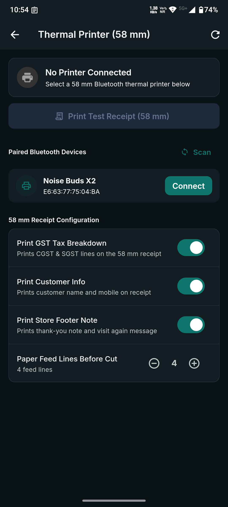<br><sub>*Bluetooth Pairing, Test Print & Layout Options*</sub> | 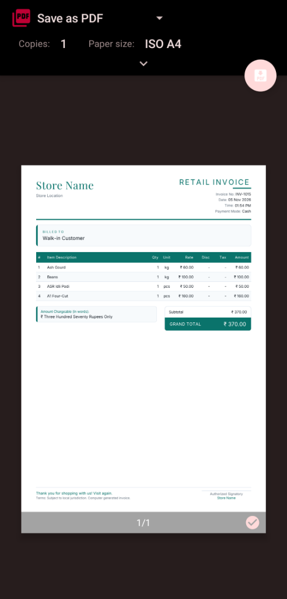<br><sub>*Indian Words & GST Breakdown*</sub> |

### 👥 Customer Udhaar Ledger & ESC/POS Print
| Customer Udhaar (Credit) Ledger | 58 mm Thermal Receipt Preview |
|:---:|:---:|
| 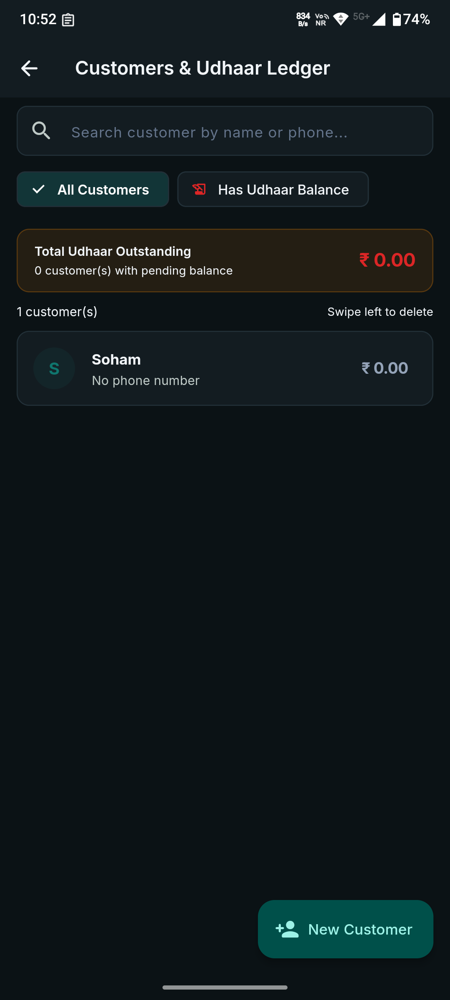<br><sub>*Receivables, WhatsApp Reminders & Swipe-to-Delete*</sub> | 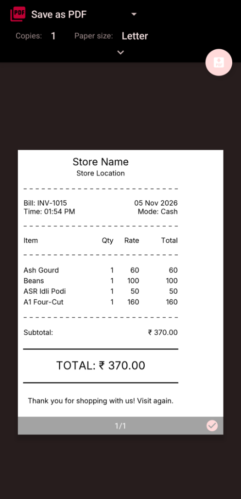<br><sub>*Compact 32-Col ESC/POS Print*</sub> |

---

## 13. Project Structure

```text
Shopmate/
├── android/                    # Native Android project configuration (Kotlin DSL)
├── assets/                     # Application assets
│   ├── fonts/                  # Custom typography (Inter, Playfair Display)
│   ├── icons/                  # Application iconography
│   └── images/                 # App logo and splash graphics
├── docs/                       # Project documentation & captures
│   └── screenshots/            # Application screenshots
├── lib/                        # Flutter source code
│   ├── core/                   # Shared architectural core (DB, theme, routing)
│   ├── features/               # Modular business feature packages
│   └── main.dart               # Bootstrap entry point and orientation lock
├── test/                       # Unit and widget test suite (97 tests)
├── .gitignore                  # Git ignore rules for Flutter & Android
├── analysis_options.yaml       # Dart analyzer rules
├── pubspec.yaml                # Package manifest and dependencies
├── pubspec.lock                # Locked dependency tree
└── README.md                   # Project documentation
```

---

## 14. Future Improvements

While Shopmate POS provides a comprehensive, production-grade offline POS system, potential future expansions include:
- **Local Peer-to-Peer Counter Sync**: Synchronize multiple POS counters on the same local Wi-Fi router using mDNS and SQLite changesets without internet.
- **Cloud Backup Integration**: Optional automated backup uploads to Google Drive or Nextcloud via user-configured OAuth.
- **Customer-Facing Second Display**: Support for secondary HDMI or network-attached customer displays.
- **Direct Electronic Scale Interface**: Serial (RS232) and USB HID integration to read continuous weight directly from digital weighing scales.
- **Multi-Language Support**: Regional language localization (Hindi, Tamil, Telugu, Malayalam, Kannada, Marathi).

---

## 15. Developer Information

* **Developer**: Srikanth
* **GitHub Profile**: [@itz-sk-luffy](https://github.com/itz-sk-luffy)
* **Project Repository**: [https://github.com/itz-sk-luffy/Shopmate.git](https://github.com/itz-sk-luffy/Shopmate.git)
* **Application Package Name**: `com.shopmate.pos`
* **Current Application Version**: `1.0.0+1`
* **Target Platforms**: Android (Phones & Tablets)
* **Contact Email**: jokerupayan@gmail.com
